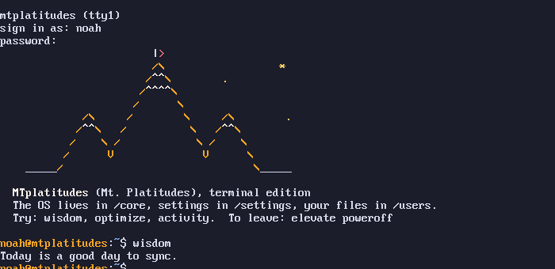

# Mt. Platitudes

"MT" is also short for *Mount*, so the logo is Mt. Platitudes: an amber,
snow-capped mountain. The flag on the summit says nothing, which is the point.

| File | What it is |
|---|---|
| `mountain.txt` | The ASCII art shown on the console after signing in |
| `mountain.colors` | The same grid with one color letter per character |
| `make-terminal-art.py` | Turns the two into the welcome screens in `files/core/share/` |
| `icon.svg` / `icon.png` | Round icon (vector, and a 256 px render) |
| `console.png` | How it looks on the machine's own screen |

The console's 16 colors come from `files/settings/console-colors`. After
editing the art, its colors or the palette, run
`python3 branding/make-terminal-art.py` from the repository root.

